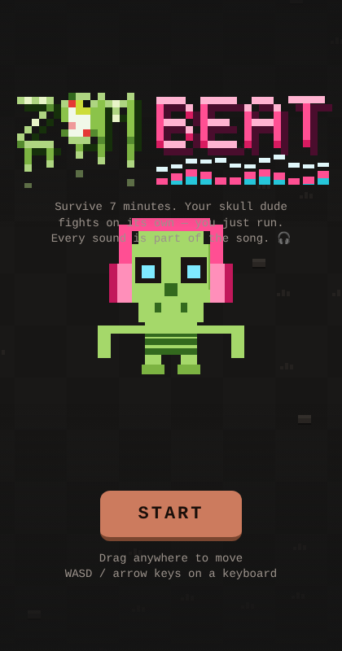
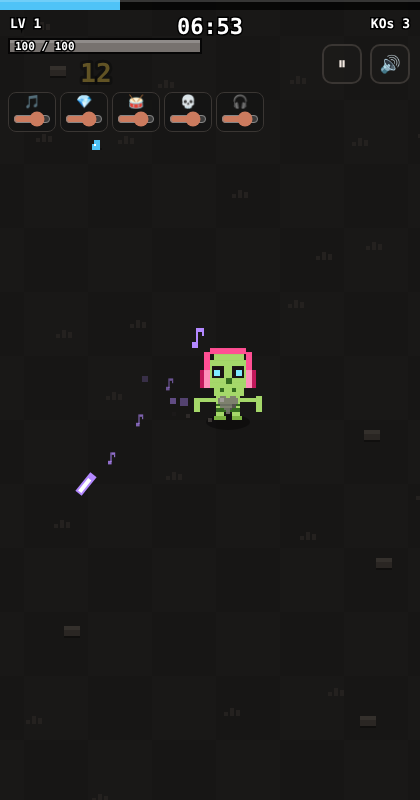

# ZomBeat 🎧💀

A tiny browser game where every sound is part of the song. Your skull dude fights on its own, so all you do is run.

**[▶ Play it here](https://kharlemagne.github.io/zombeat/)**

 

## How to play
- Survive 7 minutes.
- **Touch:** drag anywhere to move.
- **Keyboard:** WASD or arrow keys.
- Level up to pick new skills. Each skill adds its own instrument to the music, and the mixer sliders let you turn each one up or down.
- Each boss brings in a new score.

## About
Built as a single self-contained `index.html` (HTML, CSS and JavaScript, with no libraries or external files). The music is generated live in the browser and the combat is synced to the beat. It was vibe-coded with Claude and is a learning project that I keep updating.

## Run it locally
Download `index.html` and open it in any modern browser.

## Roadmap
- [ ] Add ideas here as you go

Made by Kharlemagne
